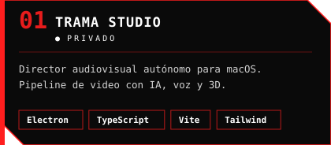
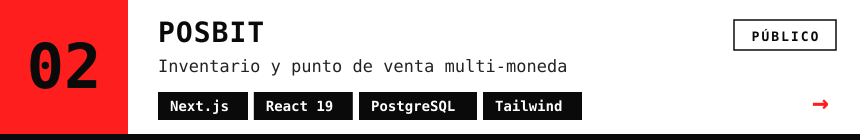
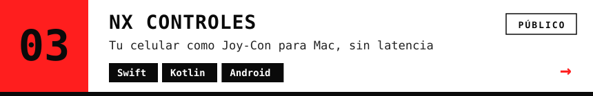
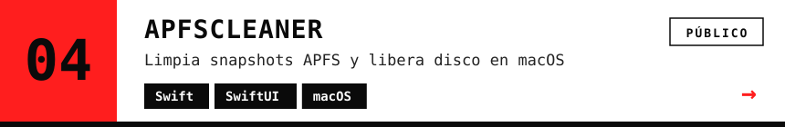
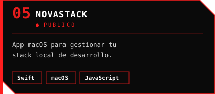
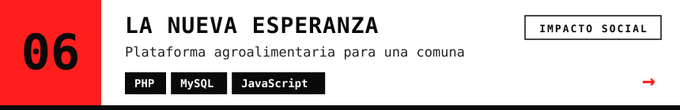

 

 

## ▍SOBRE MÍ

 

## ▍PROYECTOS

<table>
<tr><td></td><td></td></tr>
<tr><td></td><td></td></tr>
<tr><td></td><td></td></tr>
</table>

Haz clic en una tarjeta para abrir el repositorio · TRAMA Studio es privado

 

## ▍STACK

 
 

 

## ▍NÚMEROS

<picture>
  <source media="(prefers-color-scheme: dark)" srcset="https://raw.githubusercontent.com/josechkonn/josechkonn/output/github-snake-dark.svg" />
  
</picture>

 

