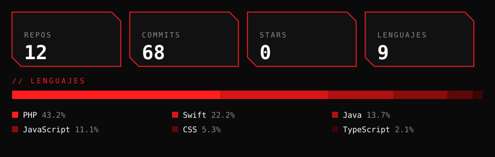

 

 

## ▍SOBRE MÍ

 

## ▍PROYECTOS

| | PROYECTO | QUÉ HACE | STACK |
|:-:|:--|:--|:--|
| **01** | [**TRAMA Studio**](https://github.com/josechkonn/trama-studio) ` PRIVADO ` | Director de video autónomo para macOS con IA |    |
| **02** | [**PosBit**](https://github.com/josechkonn/PosBit)  | Inventario y punto de venta multi-moneda |    |
| **03** | [**NX Controles**](https://github.com/josechkonn/nxcontroles)  | Tu celular como Joy-Con para Mac |    |
| **04** | [**APFSCleaner**](https://github.com/josechkonn/APFSCleaner)  | Limpia snapshots APFS y libera disco |   |
| **05** | [**NovaStack**](https://github.com/josechkonn/NovaStack)  | Gestiona tu stack local de desarrollo |   |
| **06** | [**La Nueva Esperanza**](https://github.com/josechkonn/lanuevaesperanza) ` SOCIAL ` | Plataforma agroalimentaria para una comuna |   |

TRAMA Studio es privado, por eso su enlace no abre.

 

## ▍STACK

 
 

 

## ▍NÚMEROS

<picture>
  <source media="(prefers-color-scheme: dark)" srcset="https://raw.githubusercontent.com/josechkonn/josechkonn/output/github-snake-dark.svg" />
  
</picture>

 

